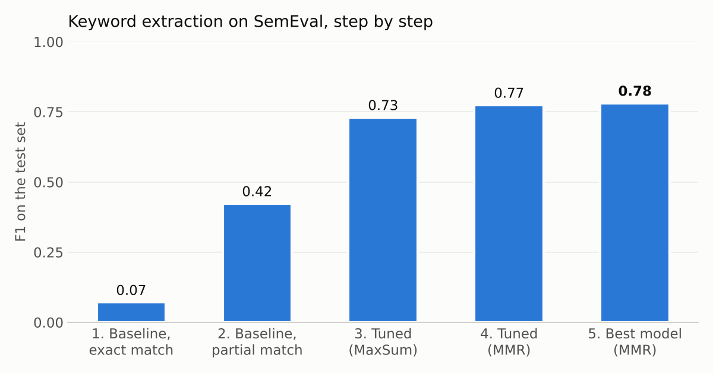

# Keyword Extraction with KeyBERT

This project finds the **most important words in a text** (its keywords), using **KeyBERT**, and tunes it to work as well as possible.

It was a team project for the **Natural Language Processing** course at **Politecnico di Torino**.
Author: **Alimohammad (Ali) Rahmatpour**.

---

## My part

This was a **team project**.

- **My part was the baseline:** the first full KeyBERT pipeline, how we score it, and its first results (notebooks **01** and **02**).
- The rest (tuning, comparing models and the new-domain test) was done by my teammates. It is here so the whole project can be seen in one place.

---

## The idea in short

1. Each sentence in the dataset has **two marked words**. These are the "true keywords".
2. KeyBERT reads the sentence and picks **2 keywords**.
3. We check how many of them match the true ones.
4. We started from a simple baseline, then changed one thing at a time: **how we score**, **the settings**, and **the model**.
5. At the end, we tried the best setup on a **new kind of text**: long sports news.

**Main finding:** tuning raised the test F1 from **0.42** (baseline) to **0.78**. But on long news articles, the same setup drops to **0.28**.

---

## How KeyBERT works

- **Step 1:** it turns the whole text into an **embedding** (a list of numbers that describes its meaning), using a ready-made language model.
- **Step 2:** it makes a list of **candidate phrases** from the text (1, 2 or 3 words long), without common words like "the" or "of".
- **Step 3:** it turns each candidate into an embedding too, and picks the ones **closest in meaning** to the whole text.

There are two ways to pick the final keywords, so they are not all the same:

| Method | How it picks |
|---|---|
| **MaxSum** | Takes the `nr_candidates` best phrases, then picks the ones that are **most different** from each other. |
| **MMR** | Picks phrases one by one. Each new one must be close to the text, but different from the ones already picked. `diversity` says how much "different" matters (0 to 1). |

**Score:** precision, recall and **F1** (higher is better, 1.0 is perfect).

---

## Exact match vs partial match

This was the first thing I found while building the baseline.

**Example:**
- Sentence: *"The system ... has its greatest application in an arrayed configuration of antenna elements."*
- True keywords: `configuration`, `elements`
- KeyBERT picked: `greatest`, `antenna elements`

With **exact match**, `antenna elements` is wrong, because it is not exactly `elements`. That is too strict.
With **partial match**, it counts, because it **contains** the true word.

| Baseline | Test precision | Test F1 |
|---|---|---|
| Exact match | 0.07 | 0.07 |
| Partial match | **0.42** | **0.42** |

All the next steps use partial match.

---

## Main results

All numbers are on the **SemEval test set** (2,717 sentences), except the last row.

| Step | Notebook | What changed | Precision | Recall | F1 |
|---|---|---|---|---|---|
| 1 | 01 | Baseline: KeyBERT defaults, exact match | 0.071 | 0.071 | 0.071 |
| 2 | 02 | Baseline with **partial match** | 0.423 | 0.423 | 0.423 |
| 3 | 03 | Clean text + **MaxSum**, 3-word phrases, nr_candidates = 4 | 0.730 | 0.730 | 0.730 |
| 4 | 04 | **MMR** instead, 3-word phrases, diversity = 0.4 | 0.795 | 0.764 | 0.774 |
| 5 | 06 | Same, with the **paraphrase-MiniLM-L6-v2** model | **0.801** | **0.771** | **0.781** |
| 6 | 07 | Step 5 on **KPTimes** (sports news), 3 keywords | 0.238 | 0.396 | 0.282 |



**Comparing models** (test set, 3-word phrases):

| Model | MaxSum F1 | MMR F1 |
|---|---|---|
| paraphrase-MiniLM-L6-v2 | **0.738** | **0.781** |
| all-mpnet-base-v2 | 0.730 | 0.769 |
| roberta-large | 0.663 | 0.700 |
| albert-base-v2 | 0.659 | 0.676 |
| roberta-base | 0.649 | 0.668 |

**What we learned:**

- **How you score matters a lot.** Exact match made a working method look broken (0.07). Partial match is closer to what a person would say.
- **Longer phrases score best.** 3-word phrases gave the best score with both methods.
- **MMR beats MaxSum**, with diversity around **0.4 to 0.5**.
- **Small sentence models win.** The two models made for sentence meaning (MiniLM, MPNet) beat RoBERTa and ALBERT. A likely reason: RoBERTa and ALBERT were not trained to make sentence embeddings.
- **Long texts are much harder.** On sports news, F1 drops from 0.78 to 0.28. A likely reason: a long article has many more candidate phrases to choose from, and its true keywords are often names of people or teams.

---

## The notebooks

All code is in the `codes` folder. They are in the order we made them.

| # | Notebook | What it does |
|---|---|---|
| 01 | baseline_exact_match | First KeyBERT run, scored with exact match **(my part)** |
| 02 | baseline_partial_match | Same run, scored with partial match **(my part)** |
| 03 | maxsum_tuning | Text cleaning + 20 MaxSum settings (phrase length × nr_candidates) |
| 04 | mmr_tuning | Text cleaning + MMR settings (phrase length × diversity) |
| 05 | models_maxsum | Best MaxSum settings with 5 models |
| 06 | models_mmr | Best MMR settings with 5 models |
| 07 | new_domain_kptimes | Best setup on KPTimes sports news |
| 08 | results_and_plots | Collects all results, finds the best settings, draws the plots |

**Settings tried:**

| Setting | Values |
|---|---|
| Phrase length | 1-2, 1-3, 2, 2-3, 3 words |
| nr_candidates (MaxSum) | 2, 3, 4, 5 |
| diversity (MMR) | 0.2, 0.3, 0.4, 0.5, 0.6 |
| Keywords per text | 2 (SemEval), 3 (KPTimes) |

**Text cleaning** (from notebook 03 on): lowercase, and remove links, @mentions, #hashtags, punctuation and extra spaces.

The `results` folder has every score as a small table (CSV), one file per notebook.

---

## How to run

```
pip install -r requirements.txt
jupyter notebook
```

- The notebooks were made for **Google Colab**. The first cells install the libraries with `!pip install`. On your own computer, you can skip them.
- They save the results to Google Drive. To run them, change the `filename` path in the `save` function.
- SemEval downloads by itself. KPTimes must be downloaded first. See [DATA.md](DATA.md).

---

## Good to know

- **Nothing is trained.** KeyBERT uses ready-made language models. "Train" and "test" here are just two parts of the data. The settings were picked on the train part, and the test part gave the same winners.
- **Partial match is generous with long phrases.** A 3-word phrase has more chances to contain the true word. This is part of why 3-word phrases score best.
- **The baseline uses the raw text. From notebook 03 on, the text is cleaned.** So the jump from step 2 to step 3 comes from both the cleaning and the new settings.
- **In MMR, `nr_candidates` does nothing.** KeyBERT only uses it with MaxSum. That is why the MMR results only change with phrase length and diversity.
- **One small fix in notebook 01:** two lines that reset the lists for each batch were missing (notebook 02 has them). I added them. The saved output comes from the run before the fix, so the 0.07 score may be a little off.
- The notebooks are uploaded **as they were run**, with their outputs.
